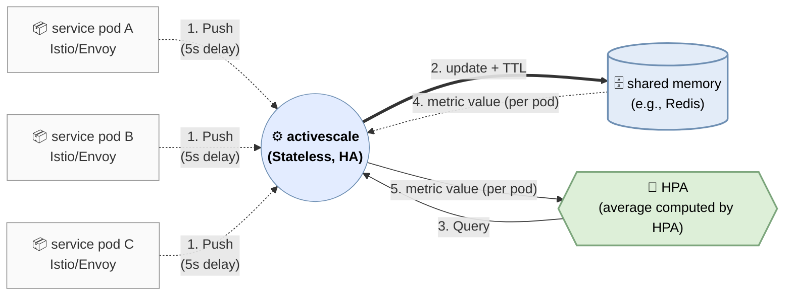

# Activescale

Activescale enables fast Kubernetes autoscaling with push-based, per-pod active request and connection metrics from Envoy.

`Active` means currently in flight: requests not yet completed and connections still open. By Little's Law (`L = λW`), active requests reflect both request rate and latency.

Unlike CPU and memory metrics collected through metrics-server, Envoy pushes active signals directly to Activescale, avoiding extra scrape and polling delays.

## Documentation

- **Guide**: [한국어](doc/guide-kr.md) | [English](doc/guide-en.md) — metric selection, HPA configuration, and verification
- **Motivation**: [한국어](doc/motivation-kr.md) | [English](doc/motivation-en.md) — rationale, latency comparison, and architecture
- **Test results**: [한국어](doc/test-results-kr.md) | [English](doc/test-results-en.md) — scaling responsiveness, Scale-out Coverage, and estimated resource utilization summary
- **Kubernetes manifest example**: [k8s-manifest-example.yaml](k8s-manifest-example.yaml) — deployment and HPA example requiring Redis, ServiceAccount/RBAC, serving certificates, and a target workload

## Local development

Run the tests and build the adapter with the Go version in `go.mod`.

```sh
go test ./...
go build -o bin/activescale ./cmd/activescale
```

To run the adapter with an accessible Kubernetes API and a local standalone Redis, run:

```sh
REDIS_CLUSTER=false REDIS_ADDR=localhost:6379 go run ./cmd/activescale
```

## Image releases

GitHub Actions tests pull requests and publishes the `linux/amd64` and `linux/arm64` image to GHCR from `main`. The workflow uses the latest stable Git tag reachable from the release commit and applies the highest Conventional Commit bump since that tag. A breaking change bumps the major version, `feat` bumps the minor version, and `fix` or `perf` bumps the patch version. Changes to the Go code, Go dependencies, Dockerfile, or Docker build context rules default to a patch bump when the commit history has no higher bump. Documentation-only changes without a release-worthy commit skip publishing.

Each release has a matching Git tag such as `v0.2.0` and image tag such as `ghcr.io/anyflow/activescale:0.2.0`.

## Features

- Active request concurrency as an autoscaling signal that reflects both request rate and request latency
- Push-based Envoy `StreamMetrics` ingestion without intermediary Prometheus scrape and KEDA polling delays
- Pod-scoped Custom Metrics API values that HPA averages across workload replicas
- Direction-aware `inbound_active_requests` and `outbound_active_requests`, plus aggregate `active_connections`
- Stateless high availability with shared Redis/Valkey state and TTL-based stale metric expiry
- Redis standalone and Cluster modes with optional TLS
- Configurable gRPC receive limit and Klog-based summary and debug logging

## Metrics

- `inbound_active_requests`: inbound in-flight HTTP requests from `http.inbound_*.downstream_rq_active`
- `outbound_active_requests`: outbound in-flight HTTP requests from `http.outbound_*.downstream_rq_active`
- `active_connections`: open connections across aggregate Envoy service listeners from `listener.<address>.downstream_cx_active`

All metrics are exposed as pod-scoped custom metrics for HPA.

### Choosing a request metric

Choose the metric based on the role of the workload being scaled.

| Workload | Metric | When to use |
| --- | --- | --- |
| Application or API service | `inbound_active_requests` | Use for a workload that receives and processes client requests. This is the default choice for typical services. |
| Dedicated gateway or proxy | `outbound_active_requests` | Use when the workload primarily forwards client requests to upstream services and `inbound_active_requests` is unavailable or does not reflect the traffic. |

Do not configure both metrics as a fallback. For a normal application, outbound requests usually represent calls to dependencies and can trigger scaling for unrelated downstream traffic.

If the workload role is unclear, generate a small amount of client traffic and query both metrics. Select the one that returns per-pod values and increases with the client request concurrency being tested.

```bash
kubectl get --raw '/apis/custom.metrics.k8s.io/v1beta2/namespaces/<ns>/pods/*/inbound_active_requests?labelSelector=<selector>'

kubectl get --raw '/apis/custom.metrics.k8s.io/v1beta2/namespaces/<ns>/pods/*/outbound_active_requests?labelSelector=<selector>'
```

## Architecture



## Envoy Metrics Message Shape

Activescale receives Envoy gRPC `StreamMetrics` messages. Each message contains a node identity and a list of metric families. A simplified shape:

```json
{
  "identifier": {
    "node": {
      "id": "sidecar~10.0.0.1~my-pod.my-ns~my-ns.svc.cluster.local",
      "metadata": {
        "NAME": "my-pod",
        "NAMESPACE": "my-ns"
      }
    }
  },
  "envoy_metrics": [
    {
      "name": "http.inbound_0.0.0.0_8080;.downstream_rq_active",
      "metric": [
        { "gauge": { "value": 3 } }
      ]
    },
    {
      "name": "http.outbound_0.0.0.0_8080;.downstream_rq_active",
      "metric": [
        { "gauge": { "value": 4 } }
      ]
    },
    {
      "name": "listener.0.0.0.0_8080.downstream_cx_active",
      "metric": [
        { "gauge": { "value": 12 } }
      ]
    },
    {
      "name": "cluster.xds-grpc;.circuit_breakers.default.cx_pool_open",
      "metric": [
        { "gauge": { "value": 1 } }
      ]
    }
  ]
}
```

Pod identity extraction prefers `node.metadata.NAME` and `node.metadata.NAMESPACE`.
If either metadata field is missing, activescale falls back to parsing the Istio-style `node.id`
(`sidecar~<ip>~<pod>.<namespace>~<namespace>.svc.cluster.local`).

### Summary Counters Meaning

- `messages`: number of `StreamMetrics` messages received (one `Recv()` call).
- `stored_metrics`: number of metric writes stored in Redis for accepted request and connection samples.
- `dropped_by_ids`: messages dropped because pod identity could not be extracted.
- `dropped_by_names`: metric families skipped because their name did not match the inbound, outbound, or aggregate service listener rules.

`stored` does not necessarily equal `messages` because a message can contain multiple metric families or multiple samples, and `dropped_by_names` is counted per metric family, not per message.

## Debugging

Check Custom Metrics API is registered:
```bash
kubectl get --raw '/apis/custom.metrics.k8s.io/v1beta2'
```

Query inbound active requests with a selector:
```bash
kubectl get --raw '/apis/custom.metrics.k8s.io/v1beta2/namespaces/<ns>/pods/*/inbound_active_requests?labelSelector=app=<app>'
```

Query outbound active requests with a selector:
```bash
kubectl get --raw '/apis/custom.metrics.k8s.io/v1beta2/namespaces/<ns>/pods/*/outbound_active_requests?labelSelector=app=<app>'
```

Query active connections with a selector:
```bash
kubectl get --raw '/apis/custom.metrics.k8s.io/v1beta2/namespaces/<ns>/pods/*/active_connections?labelSelector=app=<app>'
```

Check activescale ingest logs:
```bash
kubectl logs -n ns-observability deploy/activescale | rg -n "stored (inbound_active_requests|outbound_active_requests|active_connections)|skipping metric name|missing pod identity"
```

Enable debug logs and restart:
```bash
kubectl -n ns-observability set env deploy/activescale LOG_VERBOSITY=4
kubectl -n ns-observability rollout restart deploy/activescale
```

Confirm Envoy bootstrap includes the metrics service:
```bash
istioctl proxy-config bootstrap <pod> -n <ns> | rg -n "envoyMetricsService|metrics_service|envoy_grpc|cluster_name|activescale|9000"
```

A minimal Kubernetes reference example lives in
`k8s-manifest-example.yaml`.

## Notes

Activescale reads both Envoy HTTP connection manager and listener stats, depending on the metric.

- Activescale exposes inbound and outbound HTTP connection-manager request metrics separately.
- `http.admin.*`, `http.agent.*`, and Prometheus-style `envoy_http_downstream_rq_active` aliases are ignored.
- `active_connections` accepts aggregate `listener.<address>.downstream_cx_active` families for service listener ports.
- Worker breakdowns such as `listener.<address>.worker_0.downstream_cx_active` and [Istio-reserved proxy ports](https://istio.io/latest/docs/ops/deployment/application-requirements/#ports-used-by-istio) for admin, failure detection, debug, telemetry, health, and DNS are ignored.
- Traffic-path listeners for outbound (`15001`), inbound (`15006`), and HBONE (`15008`) remain eligible.

## Appendix

### Missing metric values

Each observed Envoy gauge has a Redis TTL of `20s` by default, configurable through `METRIC_TTL` or `--ttl`. Receiving another metric for the same Pod leaves this value and its TTL unchanged.

- A current value of `0` indicates that Envoy reported a zero gauge.
- A Pod without a current value is omitted from selector results. When no selected Pod has a current value, the API returns `HTTP 200` with `items: []`.
- A named Pod lookup without a current value returns `HTTP 404 NotFound`. Unsupported metrics and resource types also return `404`.
- Redis failures surface as request errors.

Kubernetes HPA handles missing metrics conservatively. When one metric is unavailable, another valid metric can still trigger scale-up. Scale-down requires successful evaluation of the configured metrics. [HPA algorithm](https://kubernetes.io/docs/concepts/workloads/autoscaling/horizontal-pod-autoscale/#algorithm-details)
